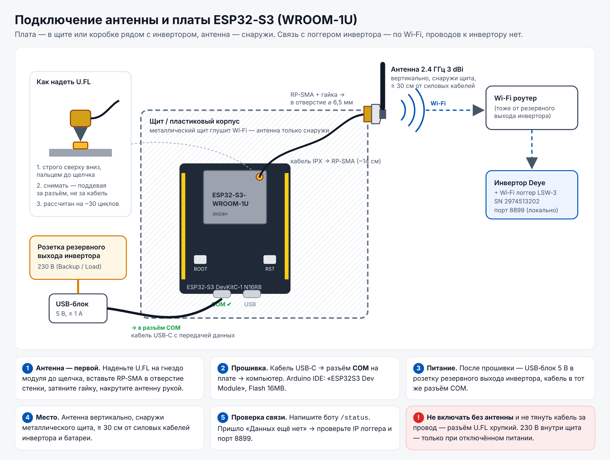

# Deye Watcher — мониторинг Deye в Telegram через ESP32

Плата ESP32 по Wi‑Fi читает инвертор Deye **через штатный логгер Solarman** (локальная сеть, порт 8899) каждые 10 секунд и присылает в Telegram:

- 🔴 / 🟢 **сеть пропала / появилась** — с длительностью отключения;
- 🟡 **пропала одна фаза** (L1/L2/L3) — для трёхфазных инверторов;
- 🪫 **заряд батареи** упал до 50 / 30 / 20 / 10 % — с прогнозом, на сколько хватит;
- ⚠️ **авария инвертора**, 📵 **логгер не отвечает**.

Облако Deye и приложение Solarman продолжают работать. К инвертору ничего не подключается, прошивка **только читает** регистры.

Плата: **ESP32‑S3 WROOM‑1U с внешней антенной** (подойдёт любая ESP32 на модуле). Инвертор: Deye **SUN‑30K‑SG01HP3** (трёхфазный HV), логгер **LSW‑3**, серийник 29xxxxxxxx.
Для логгеров с серийником на 26 (закрытый локальный доступ) нужен кабель RS‑485 — см. [README.md](../README.md), раздел про шлюз инвертора.

## Что купить (выбранный комплект)
| Что | Цена | Где |
|---|---|---|
| **ESP32‑S3 DevKitC‑1 N16R8, модуль ESP32‑S3‑WROOM‑1U** (разъём IPEX/U.FL под внешнюю антенну), 2× USB Type‑C, гарантия 4 мес. | 567,05 грн | [printec.ua](https://printec.ua/ua/p3039085903-plata-razrabotki-esp32.html) (в наличии 50 шт на 19.11.2026) |
| **Антенна Wi‑Fi 2.4 ГГц 3 dBi**, RP‑SMA, кабель IPX ~14 см | 59 грн | [arduino.ua](https://arduino.ua/ru/prod5634-antena-wi-fi-2-4ggc-3dbi-rp-sma-plug-ipx) |
| USB‑блок 5 В 1 А + кабель USB‑C **с передачей данных** | ~120–160 грн | подойдёт зарядка от телефона |

**Итого ≈ 750–790 грн.** Питать от **резервного выхода инвертора**, как и Wi‑Fi роутер.

⚠️ **Антенну подключить ДО первого включения.** Модуль «U» без антенны почти не ловит, а передатчику без нагрузки вредно. Плату можно ставить в щит, а антенну вывести **наружу**: металлический щит глушит сигнал.

Другие подходящие платы — на экранированных модулях Espressif: ESP32‑C3‑DevKitM‑1 ([printec, 212 грн](https://printec.com.ua/dev-board-esp32-c3-devkitm-1/)), ESP32‑DevKitC WROOM‑32U Type‑C (~300 грн на [Prom](https://prom.ua/ua/Esp32-wroom-32u.html)).
⚠️ **ESP32‑C3 SuperMini не рекомендую:** антенна стоит рядом с кварцем, слабый стабилизатор ([Reddit](https://www.reddit.com/r/esp32/comments/1r37gmk/esp32c3_super_minis_wifi_not_working/)). Если уже есть — `WIFI_TX_LIMIT = true`.

### Схема подключения

### Настройки Arduino IDE для ESP32‑S3 N16R8
| Пункт меню Tools | Значение |
|---|---|
| Board | **ESP32S3 Dev Module** |
| Flash Size | 16MB (128Mb) |
| PSRAM | Disabled (прошивке не нужна; для N16R8 можно OPI PSRAM) |
| USB CDC On Boot | Disabled — если прошиваете через разъём **COM/UART** |
| Port | разъём с подписью **COM** (или UART) — через мост CH343P, самый простой путь |

Если плата не прошивается, зажмите **BOOT**, нажмите и отпустите **RST**, отпустите BOOT — и повторите загрузку.

## Установка за 15 минут
1. **IP логгера.** Откройте список клиентов в роутере и найдите логгер (MAC начинается на D4:27:87). Сделайте для него **резервирование адреса (DHCP reservation)**, чтобы IP не менялся.
2. **Проверка порта.** С телефона (приложение Fing → порты) или компьютера: `nc -z <IP логгера> 8899`. Порт должен быть открыт.
3. **Бот Telegram.** У [@BotFather](https://t.me/BotFather) → `/newbot` → получите токен.
4. **Arduino IDE.**
   - Ядро ESP32: Boards Manager → «esp32 by Espressif».
   - Библиотеки: **UniversalTelegramBot**, **ArduinoJson 7.x**.
   - Плата: «ESP32C3 Dev Module» с **USB CDC On Boot: Enabled**, или «ESP32 Dev Module» для DevKit.
5. **Настройки в начале `Deye_Watcher.ino`:** Wi‑Fi, токен, `LOGGER_IP`, `LOGGER_SN` (серийник **логгера**, у вас 2974513202). `CHAT_ID` узнаете так: прошейте, напишите боту `/id`, впишите ID и прошейте ещё раз.
6. **Проверка данных.** Напишите боту `/status` и сравните заряд, нагрузку, напряжения фаз с приложением Solarman. Если что-то не совпадает — пришлите вывод `/raw`.
7. **Прогноз.** `/cap 30` — ёмкость батареи в кВт·ч; `/minsoc 10` — минимальный разряд, как в настройках инвертора.

## Команды
| Команда | Что делает |
|---|---|
| `/status` | Батарея (%, В, кВт, °C, прогноз), нагрузка, солнце, сеть по фазам |
| `/grid` | Коротко: фазы + заряд |
| `/day` | Энергия за сегодня: солнце, потребление, сеть, батарея |
| `/cap 30`, `/minsoc 10` | Параметры прогноза |
| `/alerts 50 30 20 10` | Пороги уведомлений о заряде |
| `/raw` | Сырые значения регистров — для проверки |
| `/id` | Ваш chat ID |

Локальный API: `http://<IP ESP32>/api/status` — JSON для Home Assistant, скриптов и графиков.

## Важно
- **Счётчики энергии.** При прошивке инвертора **MAIN ≥ 1098** счётчики энергии в целых кВт·ч — поставьте `ENERGY_WHOLE_KWH = true`. У прошивки 1066 оставьте `false` ([источник](https://gridzeno.com/dk/en/kompatibilitet/deye-hybrid-hv/)).
- **Порт 8899 без пароля.** Не открывайте его в интернет, по возможности держите логгер в отдельной сети.
- **Частота опроса.** Логгер не любит частые запросы: не ставьте `POLL_MS` меньше 5000.

## Источники
- Карта регистров: [kellerza/sunsynk — three_phase_common.py](https://github.com/kellerza/sunsynk/blob/main/src/sunsynk/definitions/three_phase_common.py), [three_phase_hv.py](https://github.com/kellerza/sunsynk/blob/main/src/sunsynk/definitions/three_phase_hv.py) (Apache‑2.0)
- Протокол логгера: [pysolarmanv5](https://github.com/jmccrohan/pysolarmanv5), идея — [ifreework.com](https://ifreework.com/en/blog/deye-local-monitoring/)

## Что проверено
- ✅ Кадры протокола **побайтно совпадают** с эталонной библиотекой pysolarmanv5 3.0.6. Ответы разбираются, повреждённые и чужие кадры отклоняются, keep-alive логгера пропускается.
- ✅ Сквозной тест с имитацией логгера по настоящему TCP: старт → сеть пропала (прогноз 7 ч при 80%, 3 кВт, 30 кВт·ч) → заряд 29% (одно уведомление) → сеть вернулась («не было 1 ч») → пропала фаза L2 → фазы в норме → авария → логгер молчит 3 мин → восстановился.
- ⚠️ **Не собрано компилятором ESP32 и не проверено на вашем инверторе.** Первый запуск — сверить `/status` с приложением Solarman.
