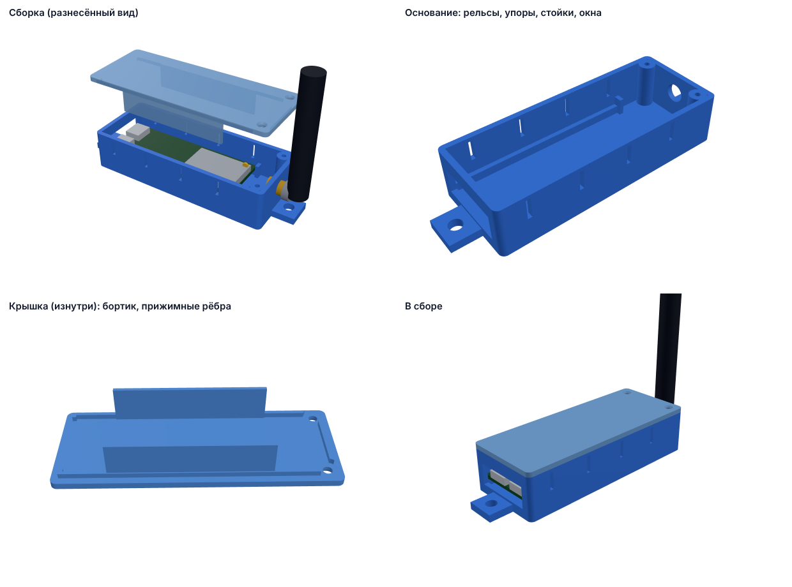
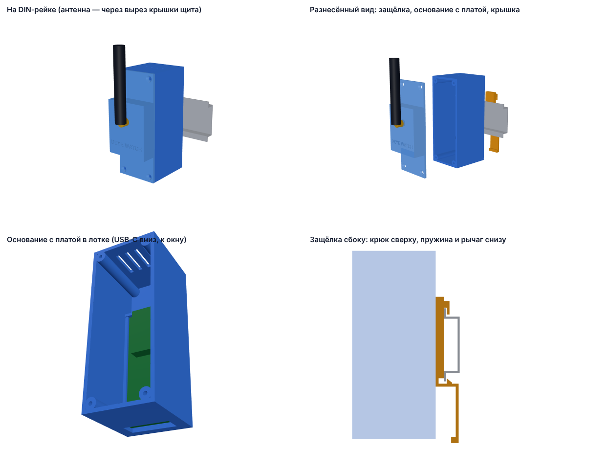

# Корпус Deye Watcher для 3D‑печати

Две версии: **настенная коробка** и **модульный корпус на DIN‑рейку** (2 модуля, в ряд с автоматами).

Под плату **ESP32‑S3 DevKitC‑1 (модуль WROOM‑1U)** без впаянных гребёнок пинов. В одном торце — окно под USB‑C, в другом — отверстие под разъём RP‑SMA внешней антенны. Есть ушки для крепления к стене.

## Антенна съёмная, разъём универсальный
На корпусе стоит **гнездо RP‑SMA** — стандарт Wi‑Fi‑антенн роутеров. В него вкручивается:
- обычная штыревая антенна 2,4 ГГц (2–5 dBi);
- **магнитная антенна на кабеле** — ставится на крышу металлического щита или выносится туда, где сигнал лучше. Пример: [Teltonika PR1KRF30, RP‑SMA, 3 dBi, кабель 1,5 м — 592 грн, enko.ua](https://enko.ua/p/antena-wi-fi-teltonika-antena-zovnshnya-magntna-rp-sma-pr1).

Внутренняя гайка гнезда сидит в **шестигранном кармане** (8,3 мм под ключ, глубина 2,2 мм) на утолщении стенки. Затягивается только наружная гайка, разъём не проворачивается, поэтому антенну можно менять сколько угодно.

Нужен пигтейл **U.FL (IPX) → RP‑SMA female, переборочный (bulkhead), с двумя гайками** — например, [Prom.ua, ≈42 грн](https://prom.ua/ua/p3091760365-pigtejl-perehodnik-sma.html) или [подборка на Prom.ua](https://prom.ua/Ufl-rp-sma.html).

⚠️ **RP‑SMA ≠ SMA.** У гнезда RP‑SMA female в центре *штырёк*, у антенны RP‑SMA male — *гнездо*. С обычной SMA резьба одинаковая, накрутится, но контакта не будет. Покупайте антенну и пигтейл с пометкой **RP‑SMA**.

## Файлы
| Файл | Что это |
|---|---|
| `deye_watcher_case.scad` | Параметрическая модель (OpenSCAD) — размеры меняются в начале файла |
| `deye_case_base_pcb63.5.stl`, `deye_case_lid_pcb63.5.stl` | Основание и крышка для платы длиной **до 63,5 мм** |
| `deye_case_base_pcb69.stl`, `deye_case_lid_pcb69.stl` | То же для платы длиной **до 69 мм** |

**Сначала измерьте плату штангенциркулем.** Длины DevKitC‑1 у разных производителей отличаются. Если ваша не подходит ни под один вариант, откройте `.scad` в бесплатном [OpenSCAD](https://openscad.org/), поменяйте `pcb_l` и `pcb_w` и экспортируйте STL: F6, затем File → Export → STL. Для отдельных деталей ставьте `part = "base"` или `"lid"`.

Габариты (вариант 63,5 мм): **83,5 × 33 × 20 мм** без ушек, с ушками — 103,5 мм в длину.

## Печать
| Параметр | Значение |
|---|---|
| Материал | **PETG** или ABS/ASA. PLA не берите: возле инвертора тепло, он поплывёт |
| Слой / периметры / заполнение | 0,2 мм / 3 / 20 % |
| Ориентация | основание — дном вниз, крышка — плоской стороной вниз |
| Поддержки | не нужны |
| Время / пластик | ≈ 1,5–2 ч, ≈ 25 г (оценка по объёму модели 21 см³) |

## Что ещё нужно
- 2 самореза 2,2–2,5 × 8 мм для крышки;
- пигтейл U.FL → RP‑SMA female bulkhead с двумя гайками, ≈42 грн ([Prom.ua](https://prom.ua/ua/p3091760365-pigtejl-perehodnik-sma.html)), и любая антенна RP‑SMA. Подойдёт штыревая или магнитная на кабеле — см. раздел выше;
- 2 шурупа ⌀4 мм, если крепите к стене.

## Сборка
1. Наверните на разъём RP‑SMA первую гайку и вставьте её изнутри в шестигранный карман на торце. Вставьте резьбу в отверстие ⌀6,6 мм, снаружи наденьте шайбу и затяните вторую гайку.
2. Наденьте IPX/U.FL на гнездо модуля **до щелчка**.
3. Положите плату на рельсы **разъёмами USB‑C к окну** и сдвиньте до упоров у дальнего края платы.
4. Закройте крышку: прижимные рёбра держат плату за края. Начинаются они за кнопками BOOT/RST, чтобы не нажимать их. Закрутите 2 самореза.
5. Накрутите антенну, подключите кабель USB‑C в разъём **COM**.

## Как проверено
- Все 4 STL — **замкнутые сетки** (watertight): проверено библиотекой trimesh, слайсер примет без ремонта.
- Сборка проверена в OpenSCAD на пересечения. Крышка с основанием — только касание по плоскости посадки, объём пересечения 0. Плата и упрощённые модели деталей на ней (USB‑C 3,3 мм, модуль с U.FL 5,7 мм) не задевают ни основание, ни рёбра крышки.
- ⚠️ **Не печаталось и не примерялось к реальной плате.** Положение USB‑C и высота разъёмов взяты по типовым размерам. Окно USB сделано широким (24 × 9 мм) с запасом. Перед печатью сверьте размеры своей платы.

---

## Версия на DIN‑рейку TS35

Формат модульного прибора: **2 модуля (36 мм) × 90 мм**. Плечи на 44 мм от рейки, лицевая панель выступа 45 мм — на 58 мм от рейки, выступ проходит в вырез крышки щита. Разъём RP‑SMA стоит на лицевой панели, поэтому антенна оказывается **снаружи щита**. Плата лежит в лотке, USB‑C смотрит вниз, кабель уходит в щит.

| Файл | Деталь | Как печатать |
|---|---|---|
| `deye_din_body_pcb63.5.stl` | основание с лотком платы | задней стенкой на стол |
| `deye_din_cap_pcb63.5.stl` | крышка с выступом и гравировкой | плечами на стол, выступ вверх |
| `deye_din_clip_pcb63.5.stl` | защёлка DIN | плашмя, как экспортирована: пружина гнётся вдоль слоёв |
| `deye_watcher_din.scad` | параметрическая модель | `part = "body" / "cap" / "clip" / "assembly"` |

**Крепёж:** 6 саморезов 2,2 × 8 мм — 2 для защёлки изнутри основания, 4 для крышки. Плату на опорные рёбра посадите на полоску двустороннего скотча.

**Сборка:**
1. Прикрутите защёлку к основанию изнутри, двумя саморезами в потай.
2. Наклейте скотч на рёбра лотка и положите плату: USB‑C к окну внизу, верхний край — в упор.
3. Наверните на RP‑SMA первую гайку, вставьте её изнутри в шестигранный карман лицевой панели, снаружи затяните вторую гайку. Наденьте U.FL на модуль до щелчка.
4. Прикрутите крышку четырьмя саморезами.
5. На рейку: зацепите верхним крюком, прижмите низ до щелчка. Снять — отвёрткой потяните рычаг защёлки вниз.

**Проверено в модели:** все детали — замкнутые сетки. Пересечений в сборке нет: основание/крышка, основание/плата, защёлка/рейка, защёлка/основание — только касания по плоскостям посадки. Верхний крюк заходит за полку рейки на 3 мм, нижний пружинный — на 1,5 мм.

⚠️ **Пружину защёлки проверьте пробной печатью.** Для освобождения она должна отогнуться на ~1,5 мм, для PETG это около 2,6 % деформации — должно хватить, но на практике не проверено. Если тугая или ломается, уменьшите зацепление нижней губы в `clip_profile()`.
